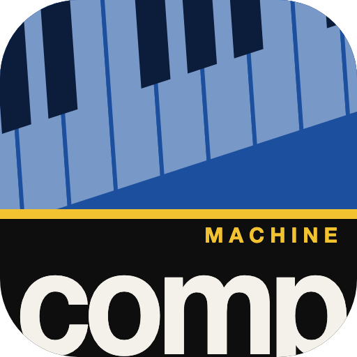

# Comp Machine

A jazz practice band for [LUNA](https://www.uaudio.com/luna). Pick a tune, or load your own
chart, and LUNA plays piano, walking bass and drums in any key, at any tempo, with the chart
following along as it plays.

- **Piano comping** with rootless voicings, or sparse shells (handy when you play guitar),
  voice-led from chord to chord.
- **Walking bass**, two-feel, ballad or bossa nova, with **drums** to match.
- **Any key and tempo.** Transposing respells the chords for the new key.
- **Loops the form** for as many choruses as you like. **New variation** re-rolls the comping
  and bass lines.
- **Lay out** drops the band for four bars at a time after the first chorus (a quiet hi-hat
  keeps the pulse) so you can check you're keeping the form.
- **Your own charts:** type them in, or upload **MusicXML** (from MuseScore, Dorico, Sibelius,
  Finale and others), **ChordPro** grids or plain text. See [CHART-FORMAT.md](CHART-FORMAT.md).
- Everything lands in your session as ordinary MIDI clips on *Comp Piano*, *Comp Bass* and
  *Comp Drums* tracks, with the changes on LUNA's chord ruler. Edit them, swap the
  instruments, record yourself over them.

## Install

Requires LUNA 3.1.1 or later on macOS.

- **From LUNA's marketplace:** Settings > ADD ONS > MARKETPLACE, find *Comp Machine*, INSTALL.
- **From this repository:** Settings > ADD ONS > MARKETPLACE > IMPORT URL, and paste
  `https://github.com/shawngrona/luna-comp-machine`.
- **From a file:** download `Comp-Machine.lunaaddon` from the
  [latest release](https://github.com/shawngrona/luna-comp-machine/releases/latest) and open it.

Then open it from **Add Ons > Windows > Comp Machine**.

## Use

1. Open a session. A new, empty one is best: the Comp Machine adds its own tracks and sets
   the session tempo.
2. Pick a tune on the left, then set the key, tempo, feel, piano style, number of choruses and
   which instruments play.
3. Press **Play** (or Space). The band is written into LUNA and loops the whole form. The chart
   highlights the bar you're on.

The instruments are Apple's built-in General MIDI synth (*DLSMusicDevice*), so it works with
nothing else installed. For better sounds, replace the instrument on the *Comp* tracks with
any piano, bass or drum plugin you own: the notes stay put.

## Built-in charts

Chord changes only, no melodies or lyrics. The library holds:

- **Public-domain songs** (in the US): *Honeysuckle Rose* (1929) and *I Got Rhythm* (1930) as
  Rhythm Changes in Bb.
- **Traditional:** *When the Saints Go Marching In*.
- **Generic forms:** jazz blues, minor blues, "Bird" blues, a minor ii-V-i form, a minor
  bossa, and a modal AABA.
- **Drills:** major and minor ii-V-Is through all keys, I-VI-ii-V turnarounds in all 12 keys,
  and ii-V-Is moving in major thirds.

Each chart shows why it is included under its title. Public-domain status is for the United
States and differs elsewhere.

## Limits

- 4/4 only for now (2/2 works too, since its bars are the same length).
- MusicXML D.C., D.S. and coda jumps are not followed: a chart plays once, as written.
- Charts you upload are kept on this computer, not in the session.

## Development

The Add On is plain HTML and JavaScript (`index.html`, `main.js`, `logic.js`, `formats.js`,
`tunes.js`), built with the LUNA Builder SDK. The SDK's script bundle is in `vendor/`.

```sh
npm install        # needs the LUNA Builder SDK; point the devDependency in package.json at your copy
npm test           # unit tests, no LUNA needed
npx ua-builder serve     # try it in a browser against a running LUNA
npx ua-builder install   # link it into LUNA's Add Ons folder
npx ua-builder pack      # build the .lunaaddon
node tests/live/check-live.mjs blues-f   # load a tune into a running LUNA and check it from a second connection
```

## Licence

MIT, see [LICENSE](LICENSE). `vendor/luna.global.js` is the LUNA Builder SDK, © Universal
Audio, Inc., under the Apache License 2.0 (see `vendor/`).

This is an independent Add On, not an official Universal Audio product. LUNA is a trademark of
Universal Audio, Inc.
